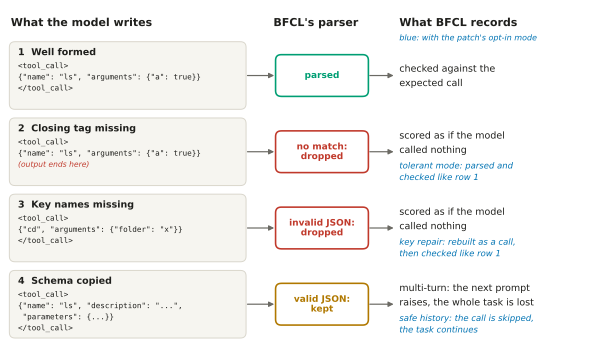
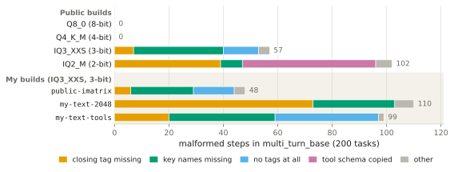
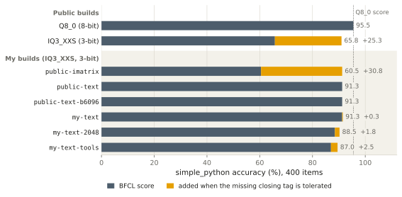
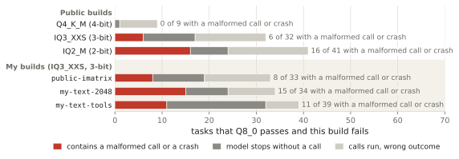

<!-- Generated by writeup/build.py from draft.template.md. Edit the template, not this file. -->

# Silent Zero: a 3-bit model drops one token, and the benchmark scores it as silence

*Draft. All numbers are filled in by `writeup/build.py` from the audit and re-scoring outputs, and the figures are drawn from the same files.*

## Abstract

Quantized GGUF files are a common way to run open-weight language models on local hardware, and tool calling is what turns those models into agents. Ask a 3-bit model for a tool call and it may write the call correctly, then stop, usually one token short. The benchmark cannot tell that apart from a model that called nothing.

This note audits how the Berkeley Function Calling Leaderboard (BFCL) scores ten GGUF builds of one model, Qwen3-4B-Instruct-2507: four public builds from 8 down to 2 bits, and six 3-bit builds of my own, each of which changes one thing about how the public 3-bit build was made, mostly its importance matrix. All builds come from the same 16-bit weights and run on the same server with greedy decoding. I classify every saved output by what BFCL's parser does with it, and re-score the single-turn outputs with a patched parser that accepts a missing closing tag. With its options off, the patched evaluator reproduces the unpatched evaluator's scores exactly.

The main findings are: (1) For the public 3-bit build, most of the score loss on `simple_python` is a format failure that BFCL records as no call at all. The public IQ3_XXS build scores 65.75% against 95.50% for 8-bit, and 25.3 of those 29.8 points come from complete calls that lack the closing `</tool_call>`. (2) On the single-turn categories, the missing tag follows one importance matrix, the public one, and not the llama.cpp version. With the tag tolerated, all seven 3-bit builds score between 89.50% and 91.50% on `simple_python`. (3) In multi-turn tasks the parser explains less. Of the 32 tasks that 8-bit passes and the public 3-bit build fails, 6 contain a malformed call or a crash and the other 26 contain none. (4) Some malformed calls crash a whole multi-turn task. At 2 bits, 25 of 200 tasks crash, 9 of them tasks that 8-bit passes. The patch in this repository reports each of these failures separately without changing any score.

## 1. How BFCL reads a tool call

BFCL's handler for Qwen-style models extracts tool calls with a single regular expression (`qwen_fc.py` at commit `6ea5797`, the latest `main` as of November 2026):

```python
pattern = r"<tool_call>\n(.*?)\n</tool_call>"
matches = re.findall(pattern, input_string, re.DOTALL)

# Process matches into a list of dictionaries
result = []
for match in matches:
    try:
        match = json.loads(match)
        result.append(match)
    except Exception as e:
        pass
return result
```

Anything that does not match, or matches but is not valid JSON, is dropped without a trace. That covers an unclosed tag, missing newlines around the JSON and invalid JSON. A single-turn item then fails as `wrong_count` ("Wrong number of functions"), exactly like a model that called nothing. In a multi-turn task the turn ends, and the handler's own log reports "Successfully decoded model response" with an empty list.

A second path is worse. A call that is valid JSON but lacks a usable `"name"` or `"arguments"` key is kept and written into the chat history. When the next prompt is built, the chat template indexes `tool_call["name"]` or `tool_call["arguments"]` and raises an exception. BFCL then records the whole multi-turn task as `inference_error`, including turns the model might have passed. Figure 1 shows the four kinds of output this note deals with and what BFCL does with each.



*Figure 1. What BFCL's parser does with four kinds of model output.* The examples are simplified, and kinds 2 to 4 all occur in the saved outputs of the low-bit builds. The blue column shows what changes with the patch's opt-in mode for that kind of output (`SILENT_ZERO_TOLERANT`, `SILENT_ZERO_REPAIR_KEYS` and `SILENT_ZERO_SAFE_HISTORY` in `patch/README.md`). All three are off by default, and then the patch only adds a label to each failed entry that records what the parser saw.

## 2. Builds and setup

A build is one GGUF file of the model. Low-bit builds are usually made with an *importance matrix* (imatrix), activation statistics for the inputs of each weight matrix that llama.cpp collects by running the 16-bit model over a calibration text. The text is cut into chunks of a fixed number of tokens. All builds come from the same 16-bit weights.

Four builds are public: Q8_0, Q4_K_M, IQ3_XXS and IQ2_M, at 8, 4, 3 and 2 bits, from `bartowski/Qwen_Qwen3-4B-Instruct-2507-GGUF` at revision `ae44f08`. Their headers record the same imatrix, computed from `calibration_datav3.txt`. Q8_0 records it but does not use it, because llama.cpp's Q8_0 quantizer ignores the imatrix. I call these the public imatrix and the public calibration text below. The public model card names llama.cpp b6096.

To find out where the missing tag comes from, I made six more 3-bit builds with llama.cpp b10964. Each one is the same as an earlier build except for one thing, and each is named after its imatrix. All seven 3-bit builds, public and mine, assign the same quantization type to each tensor, so they differ only in the imatrix and in the llama.cpp version.

| My build | Same as | Except |
|---|---|---|
| `public-imatrix` | IQ3_XXS | quantized by me with b10964, from the same imatrix file |
| `public-text` | `public-imatrix` | imatrix recomputed from the public calibration text, in 512-token chunks |
| `public-text-b6096` | `public-text` | imatrix computed with b6096, the release the public model card names |
| `my-text` | `public-text` | imatrix computed from my own general text |
| `my-text-2048` | `my-text` | 2048-token chunks instead of 512 |
| `my-text-tools` | `my-text-2048` | tool-call dialogues added to the text, which also makes it longer |

The first two steps separate the quantizer from the imatrix, the third tests the llama.cpp version behind the imatrix, and the last three change the calibration text and how it is cut.

All builds were served with llama.cpp `llama-server` (b10964) on Apple Silicon, with one slot, greedy decoding and the server prompt cache off. Greedy runs reproduced byte-identically across server restarts. I checked this for Q8_0 and IQ3_XXS on `multi_turn_base`.

The benchmark is BFCL at `6ea5797` with the model entry `Qwen/Qwen3-4B-Instruct-2507-FC`, on three categories: `simple_python` (400 items), `live_simple` (258 items) and `multi_turn_base` (200 tasks). In a multi-turn task, the user speaks in several turns, and the model answers each turn in one or more steps, one generation each. Not every build ran every category. Q4_K_M and IQ2_M ran on multi-turn only, `public-text`, `public-text-b6096` and `my-text` on single-turn only, and the other five on all three, 23 build and category combinations in all.

## 3. What the models write

### Single-turn

The public IQ3_XXS build leaves 112 of its 400 `simple_python` calls unclosed. Of these, 110 are complete, parseable calls apart from the missing tag, so the model stopped after the JSON and not in the middle of it. In 96 of the 112, only `</tool_call>` itself is missing, which is a single token in the model's vocabulary. A typical output, scored like a missing call, looks like this:

```
<tool_call>
{"name": "algebra.quadratic_roots", "arguments": {"a": 1, "b": -3, "c": 2}}
```

The 8-bit build, on the same server with the same settings, leaves 0 calls unclosed. On `live_simple`, IQ3_XXS leaves 63 of 258 unclosed.

To see what ends these outputs, I fed the first 10 unclosed ones back to the server, cut where the output had ended, and read the next-token probabilities. Of these, 8 end in the JSON's final newline, one token short. At every one of them IQ3_XXS ranks its end-of-turn token first and gives `</tool_call>` a median probability of 0.19. Q8_0, given the same text, ranks `</tool_call>` first every time. The 3-bit model ends its turn where the 8-bit model closes the call.

### Multi-turn

The 8-bit build produces 0 malformed calls in 1,827 steps. IQ3_XXS produces 57, spread over 22 tasks. The largest group is a different near miss, in which the key names go missing (33 steps):

```
<tool_call>
{"cd", "arguments": {"folder": "document"}}
</tool_call>
```

The intended call is clear, but the text is not JSON. Another 13 steps are a complete call with no tags at all. The whole output is `{"name": "ls", "arguments": {...}}`, which BFCL reads as plain text. `my-text-tools`, whose calibration text includes tool-call dialogues, does this more often, in 38 steps. Calls that use the function name as the key, such as `{"ls": {...}}`, also appear.

At 2 bits (IQ2_M), the model also starts copying the tool's schema instead of calling it, in at least 49 steps. Most of its unclosed steps also start like a schema copy (28 of 39), so for IQ2_M a missing tag is mostly not a near miss. IQ2_M also loses 25 whole tasks to the crash path described in section 1, 9 of them tasks that 8-bit passes. In 22 of the 25 the call had a `"name"` but no `"arguments"`, which is what a copied schema looks like, and in 3 the `"name"` was missing. A crashed task keeps no log, so the output that crashed it is not recorded and the shapes are inferred from the error messages.

Figure 2 puts the builds side by side. Each 3-bit and 2-bit build breaks its calls in its own way, even among builds with the same format.



*Figure 2. The 3-bit and 2-bit builds break their calls in different ways.* Malformed model steps in `multi_turn_base` per build, by kind, with the build's total number of steps. Q8_0 and Q4_K_M produce none. Three of my builds were run on multi-turn. "Other" covers invalid JSON, a missing or invalid name or arguments, and missing newlines. Tasks lost to a crash are not counted here: 25 for IQ2_M and between 2 and 6 for each 3-bit build.

## 4. Scores with the missing tag tolerated

I re-scored the saved single-turn outputs with a patched evaluator, the tolerant parser, which also accepts a final unclosed `<tool_call>` and loose whitespace around the JSON. Nothing else changes. Names, argument types and values are still checked by BFCL's own checker. The tolerant score therefore measures which call the model chose. It does not say what an agent runtime would execute, because that depends on the runtime's own parser, and I did not test how llama-server or vLLM handle an unclosed final block. Figure 3 shows how much of each build's `simple_python` score the missing tag costs, and the table below gives the exact numbers.



*Figure 3. Tolerating the missing closing tag lifts the two builds with the public imatrix to the level of my other 3-bit builds.* Slate: BFCL's score on `simple_python`. Amber: what the same saved outputs gain when the missing closing tag is tolerated. Labels give the score before and after. Dotted line: the score of Q8_0. Q4_K_M and IQ2_M were not run on single-turn.

| Build | Calls without closing tag (of 400) | BFCL score (%) | Score with the tag tolerated (%) | Difference (points) |
|---|---|---|---|---|
| *Public* | | | | |
| Q8_0 (8-bit) | 0 | 95.50 | 95.50 | 0.00 |
| IQ3_XXS (3-bit) | 112 | 65.75 | 91.00 | 25.25 |
| *Mine, all 3-bit* | | | | |
| `public-imatrix` | 134 | 60.50 | 91.25 | 30.75 |
| `public-text` | 1 | 91.25 | 91.25 | 0.00 |
| `public-text-b6096` | 1 | 91.25 | 91.25 | 0.00 |
| `my-text` | 1 | 91.25 | 91.50 | 0.25 |
| `my-text-2048` | 8 | 88.50 | 90.25 | 1.75 |
| `my-text-tools` | 11 | 87.00 | 89.50 | 2.50 |

On `live_simple` (258 items) the pattern is the same. IQ3_XXS rises from 59.69% to 79.07% and `public-imatrix` from 56.98% to 79.46%, while no other 3-bit build gains more than 2.72 points. Every category and build is in `audit/results.md`.

For IQ3_XXS on `simple_python`, the tolerant parser turns 101 items into correct answers and creates no new failures. With all patch options off, the patched evaluator reproduces the unpatched evaluator's scores and failed entries exactly, in 23 of 23 build and category combinations.

## 5. The single-turn tag loss follows one imatrix

The chain of builds in section 2 points to the imatrix. IQ3_XXS and `public-imatrix` share the public imatrix but were quantized with different llama.cpp versions, and both drop the tag often, in 112 and 134 of 400 items. `public-imatrix` and `public-text` differ only in the imatrix, and `public-text` drops the tag in 1 item. `public-text-b6096`, whose imatrix was computed with b6096, the release the model card names, also drops it in 1. Between these two releases, the llama.cpp version shifts the count but does not decide whether the tag goes missing. That holds for quantizing and for computing the imatrix. Every build with an imatrix other than the public one drops the tag in at most 11 items, whether that imatrix came from the public calibration text or from my own text.

The public imatrix was not made from the public calibration text as I downloaded it, at least not at any single chunk size. The public header records 497 chunks. The file I used is 65,959 tokens long, which gives 128 chunks at 512 tokens (the count the header of `public-text` records) and 515 at 128. No chunk size gives exactly 497 from this file, and the header does not store the chunk size. The public imatrix was therefore made from different text, with different settings, or by combining several imatrices. It was also computed from more chunks than any of mine. I have not tested other chunk sizes or options on the public calibration text, or other revisions of it, and the whole effect rests on this single imatrix.

The public imatrix alone does not produce malformed calls. Q4_K_M, whose header records the same imatrix (same file name, same chunk count), produces 0 malformed steps in multi-turn, where IQ3_XXS produces 57. Q4_K_M was not run on single-turn, so whether it drops the tag there is untested.

With the tag tolerated, the two builds with the public imatrix are as good as my other 3-bit builds on `simple_python`. On `live_simple` they score highest of the 3-bit builds, but the gaps are a handful of items with one greedy run each, so the order means little. On these two categories, most of what separated them from my other builds was the closing tag and not the choice of call.

The effect also depends on the task. `my-text-2048` leaves 8 tags unclosed on `simple_python` but 73 in multi-turn steps. IQ3_XXS does the reverse, with 112 on `simple_python` and 7 in multi-turn. A build that looks clean on one category is not necessarily clean on another, and `public-text`, `public-text-b6096` and `my-text` were only run on the single-turn categories.

## 6. What the parser does not explain

In `multi_turn_base`, the 8-bit build passes 51 of 200 tasks and IQ3_XXS passes 22. Of the 32 tasks that 8-bit passes and IQ3_XXS fails, 6 contain a malformed call or a crash. No task with a malformed step or a crash passes, for any build, so a broken call always comes with a failure. The audit does not show that it caused it.

The other 26 tasks contain no malformed call. In 11 of them, a turn ends without any call, for example right after the model announces what it is about to do ("Let me do that for you."). There is no call for a parser to recover. Replayed at 10 such announcements, IQ3_XXS ends the turn in all 10, but Q8_0, given the same text, also ends it in 7, so the stop itself is not specific to the 3-bit build. In 12, the calls run but leave the environment in the wrong state, and in 3 they return the wrong results. At 2 bits the share with a broken call is larger (16 of 41) but still a minority, and the same holds for every low-bit build (Figure 4). Some differences arise without any broken call. Q4_K_M writes no malformed call at all, yet fails 9 tasks that 8-bit passes and passes 6 that 8-bit fails. For IQ3_XXS the counts are 32 and 3, well above that floor.



*Figure 4. For every low-bit build, most of the tasks it newly fails contain no malformed call.* Each bar counts the `multi_turn_base` tasks that Q8_0 passes and the build fails. Red: tasks with a malformed call or a crash. Dark grey: a turn where the model stops without calling anything. Light grey: the calls run but leave the wrong state or return the wrong results. A parser cannot fix the grey parts. Three of my builds were run on multi-turn.

Multi-turn outputs also cannot be re-scored after the fact. A call the parser dropped was never executed, so the model never saw its result, and every later turn depends on that. Measuring how much a tolerant parser would recover in multi-turn needs a new generation run with the tolerant parser active, which this note does not include.

## 7. Limitations

The study covers one model, with one greedy run per build. Greedy decoding is reproducible, so a single run has no sampling noise, but small changes to the weights flip individual items, as Q4_K_M shows in multi-turn. Differences between near-identical imatrices would need imatrices from resampled calibration text before they mean much. The chain of builds also has gaps. Only three of my builds were run on multi-turn, the public calibration text was tried at one chunk size only, and `my-text-tools` changes the length of the text along with its content. The tolerant mode accepts only a missing final tag and loose whitespace, and the key repair in the patch (`SILENT_ZERO_REPAIR_KEYS`) matters only in multi-turn, where it needs re-generation.

Two objections come up. The missing tag is not caused by the server or a wrong stop setting, because the 8-bit build and `public-text` ran on the same server with the same settings and leave 0 and 1 tags unclosed. The outputs are not truncated either, because 110 of the 112 unclosed outputs are complete calls, and in every replayed case the model chose its end-of-turn token.

None of these builds is on the BFCL leaderboard, so no leaderboard number is claimed wrong. The finding concerns anyone who runs BFCL on a quantized build. The failure also comes from one imatrix of one model, tested on three categories, and says nothing about the publisher's other models.

## 8. Conclusion

This note asked how much of a quantized model's tool-calling score on BFCL reflects the calls it makes, and how much reflects the parser that reads them. The audit covered ten builds of Qwen3-4B-Instruct-2507 step by step, and the single-turn outputs were re-scored with a tolerant parser that leaves BFCL's checks otherwise unchanged.

The main findings are:

1. Most of the public 3-bit build's loss on `simple_python` is a missing closing tag. Of the 29.8 points it loses, 25.3 come from items whose call is complete apart from `</tool_call>`. A tolerant parser turns 101 such items into correct answers. When such outputs are replayed, the model ranks its end-of-turn token first where the tag belongs.
2. On single-turn, the missing tag follows one imatrix, the public one. On `simple_python`, the two builds with the public imatrix leave 112 and 134 tags unclosed, while every build with another imatrix leaves at most 11. Changing the llama.cpp version shifts the count but not the pattern. In multi-turn the pattern differs, as section 5 shows. The published calibration file does not reproduce the public imatrix, so its exact origin stays open.
3. For the public build, multi-turn failures are mostly not parsing failures. Of the 32 tasks that 8-bit passes and IQ3_XXS fails, 26 contain no malformed call. Whether a tolerant parser would rescue the other 6 can only be measured by re-generation.
4. Malformed calls can cost whole tasks. At 2 bits, 25 of 200 multi-turn tasks crash on a call without `"name"` or `"arguments"`, 9 of them tasks that 8-bit passes, and filtering such calls out of the chat history prevents every kind of crash inferred here (`SILENT_ZERO_SAFE_HISTORY`, tested in unit tests).

The patch in this repository makes the distinction visible without changing any score. Every failed entry gets a `tool_call_parse` field that records what the parser saw ("unclosed", "keys_dropped", "schema_echo", a crash message, or "ok" when the call was well formed but wrong), so a benchmark user can report malformed calls separately from missing ones. Anyone running a low-bit build in an agent can get the same information from a short tool-call smoke test that checks the tags specifically. Grammar-constrained decoding, which llama.cpp and vLLM both offer, should rule out syntactically malformed calls if the grammar covers the tags. I did not test it, and it cannot make a wrong call right. For people making quantized builds, a few hundred tool-call prompts are a cheap check on whether the call format survives quantization.

Several directions follow. A multi-turn run with the tolerant parser active would measure what the parser costs there, where re-scoring cannot. Imatrices from resampled calibration text would show how much of the spread between near-identical builds is noise. Other models and other BFCL handlers parse tool calls differently, so the same audit on them would show how general the missing tag is. Finally, finding the text and settings behind the public imatrix would help explain why that one imatrix makes the model drop the tag. A missing tag and a missing answer are different failures, and a benchmark should be able to tell them apart.

## Code and data

The classifier is `audit/classify.py`, and `audit/results.md` has the tables for every build and class. The BFCL patch, its tests and `verify.py` are in `patch/`. `writeup/build.py` turns the outputs into this text, and the scripts in `writeup/figures/` draw the figures.
